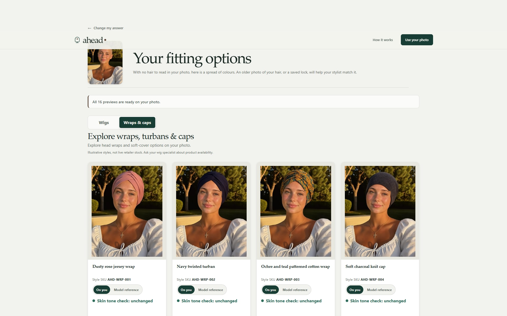

# Ahead

<p align="center">
  <strong>A private fitting room for the next look.</strong><br />
  Explore wigs and headwear on your own photo, compare the styles that feel right, and take a useful brief to a specialist.
</p>

<p align="center">
  <a href="https://try-ahead.vercel.app"></a>
  
  
  
  
  
</p>

Ahead is a private wig and headwear fitting room for people navigating treatment-related hair loss. It lets someone explore options on their own photo, keep the looks that feel like them, and take a shortlist to a specialist.

**The product promise:** more choice, more agency, and a more prepared fitting conversation. Ahead is designed to help people feel more confident exploring options, without pressuring them to choose.

> Ahead is a shopping companion, not a medical tool or a retailer. Its catalogue is illustrative: it does not show verified products, prices, stock, or confirmed availability.

## Try it

| Link | What to expect |
| --- | --- |
| [Open Ahead](https://try-ahead.vercel.app) | The live web app. |
| [Open the sample fitting room](https://try-ahead.vercel.app/capture#samples) | Explore saved sample previews without uploading a photo or spending API units. |
| [See how the YouCam API was tested](https://try-ahead.vercel.app/how-we-tested) | The measured API behaviour and why specific capabilities were chosen. |

For an own-photo try-on, choose **Use your photo**, review the consent, upload a photo, and ask to see matches. A public deployment can require a judge access code for fresh live API calls. Sample previews remain available without it.

## See Ahead

The project gallery follows one person from her own photo to live YouCam previews. Ahead keeps her face central while she explores styles privately and decides what she wants to discuss at a fitting.



| Her starting photo | Shoulder layers · black with grey blend | Short pixie · salt and pepper | Navy twisted turban |
| --- | --- | --- | --- |
|  |  |  |  |

The [Devpost project thumbnail](docs/images/devpost-thumbnail.jpg) uses the same portrait and previews.

## Why we built it

Choosing a wig during treatment-related hair loss can mean making a personal decision from product photos of someone else. Ahead puts the person back into that decision: explore style and colour on your own photo, save the looks that feel right, and bring specific references to a specialist. A private preview cannot promise confidence, but it can give someone more room to explore before a fitting.

The specialist remains central: the preview cannot tell someone whether a wig fits, feels comfortable, suits their scalp, or is available. Ahead helps make that first fitting conversation easier to start.

## The experience

1. **Choose how to begin.** Review the photo-use details and upload a photo, or explore a recorded sample person.
2. **Explore 16 directions.** Browse 12 wigs and 4 wraps or caps. When requested, live renders start together; each result remains attached to its own style.
3. **Compare and shortlist.** Flip a card between the try-on and its reference model, compare two saved looks, and note what you like.
4. **Take the conversation with you.** Create a shareable fitting brief with style references, colour notes, questions, and Ahead reference codes. The brief never contains the photo.

The preview is for exploring style and colour. It does not establish fit, density, comfort, medical suitability, retailer availability, or purchase readiness.

## Architecture

```mermaid
flowchart LR
  person[Person] -->|photo or sample choice| browser[Next.js browser app]
  browser -->|request matches: sample ID or uploaded photo| tryon[POST /api/tryon]
  tryon -->|sample ID or mock mode| fixture[Recorded YouCam result fixtures]
  fixture --> card[Style cards and comparison]
  tryon -->|live own-photo request| guard[Validate image, session, limits, credit reserve, cache]
  guard -->|source photo + on-model style reference| youcam[YouCam Hair Transfer v2.1]
  youcam -->|task ID| poll[GET /api/tryon/:id]
  poll -->|style-bound finished task| proxy[GET /api/result]
  proxy -->|same-origin image bytes| image[Browser face and skin integrity checks]
  image --> card
  card --> compare[Compare and shortlist]
  compare --> brief[Shareable fitting brief / print to PDF]
  browser -->|style preferences only| planner[POST /api/agent/plan]
  planner -->|optional text planning| llm[Groq or Gemini, with rule-based fallback]
  planner --> brief

  classDef external fill:#f1eee4,stroke:#b7b3a5,color:#24352f;
  class youcam,llm external;
```



The detailed component map, API boundaries, and request sequences are in [`docs/ARCHITECTURE.md`](docs/ARCHITECTURE.md). The API evidence page is still available at [`/how-we-tested`](https://try-ahead.vercel.app/how-we-tested); it complements the architecture by documenting measured behaviour.

### YouCam integration

The live own-photo flow uses **YouCam Hair Transfer v2.1** for wigs and headwear. The browser does not call YouCam directly and never receives the API key or a YouCam-hosted result URL.

- The server checks the selected style, photo, session, balance, daily limit, reserve, and cache before starting a paid render.
- A live Hair Transfer render costs **2 units**. The server uploads the source photo and the style’s person-wearing-the-item reference, using `hair_color: "ref"`.
- The browser polls the task, then loads the finished image from Ahead’s same-origin result proxy.
- Ahead’s browser image pipeline uses MediaPipe landmarks for an optional feathered inner-face composite and checks skin-tone consistency. These are Ahead’s checks; they are not YouCam capabilities.
- The session cleanup path asks YouCam to delete completed tasks. Uncertain create requests are not silently retried.

Recorded sample previews are saved results and cost no units. Only a person's own uploaded photo can start a live call. **Skin Tone Analysis and Makeup VTO are not live integrations in this product.** The measured reasons are documented in the [API truth table](docs/api-truth-table.md). The YouCam Beauty MCP is used for capability discovery; paid try-ons use the guarded REST integration.

## Privacy and boundaries

- Consent appears before photo capture or upload. The browser holds the selected photo in session memory; the shareable brief contains no photo.
- Ahead re-encodes uploaded photos as JPEG and strips metadata before sending them to the server/API.
- The YouCam key stays server-side. Live calls are protected by a unit ledger, caching, per-session and daily caps, a reserve, and rate limits.
- The optional planning assistant receives style preferences, notes after health-related details are removed, and sampled colours. It does not receive the photo, hair-loss stage, treatment date, or health details.
- Planner suggestions do not start paid try-ons. A person must approve a proposed live action.
- This prototype has no verified retailer SKUs, live inventory, prices, checkout, retailer partnership, or measured sales/return results. Ahead codes such as `AHD-WIG-001` are style reference codes, not retailer SKUs.

## Run locally

Requirements: Node.js and npm. In the default local mode, sample people use saved YouCam recordings. No API key or credits are needed to explore that path.

```bash
npm install
npm run dev
```

Open [http://localhost:3000](http://localhost:3000). To check the app:

```bash
npm test
npm run typecheck
npm run lint
npm run test:e2e
```

The Playwright suite builds and runs the app in mock mode in mobile and desktop browser viewports; it does not make paid YouCam calls. For fresh own-photo renders, set these server-side values in `.env.local` using [`.env.example`](.env.example):

```dotenv
YOUCAM_MODE=live
YOUCAM_API_KEY=your_server_side_key
```

Never commit `.env.local` or place the API key in client code. `TESTER_CODE` can gate live calls on a public deployment. Planner provider keys are optional; the rule-based planner fallback still works without them.

## Project map

| Area | Owns |
| --- | --- |
| `app/` | Next.js pages and server API routes. |
| `components/results/` | Results, model/you comparison, shortlist, and brief creation. |
| `catalogue/catalogue.json` | The 12 wig and 4 wrap/cap directions, identifiers, and reference images. |
| `lib/youcam/` | Server-side REST client, task lifecycle, unit safeguards, cache, and cleanup. |
| `lib/image/` | Browser image checks, face landmarks, face restoration, and feature compositing. |
| `lib/agent/` | Optional text planning, shortlist tools, approval flow, and claim/privacy guardrails. |
| `lib/store/` | Shareable brief storage with Redis or the configured local fallback. |
| `test/e2e/` | Playwright browser flows across desktop and mobile viewports. |
| `docs/ARCHITECTURE.md` | System boundaries and request sequences. |
| `docs/api-truth-table.md` | API experiments, results, and product decisions. |

## Project tags

`virtual-try-on` · `youcam-api` · `wig-shopping` · `headwear` · `cancer-support` · `beauty-tech` · `Next.js` · `React` · `TypeScript` · `Playwright`

## Image note

The supplied demo portrait is the starting point for the featured YouCam previews. Catalogue reference images are illustrative style references, not live retailer products or confirmed stock; the app communicates this once in its footer.

## Licence

MIT
