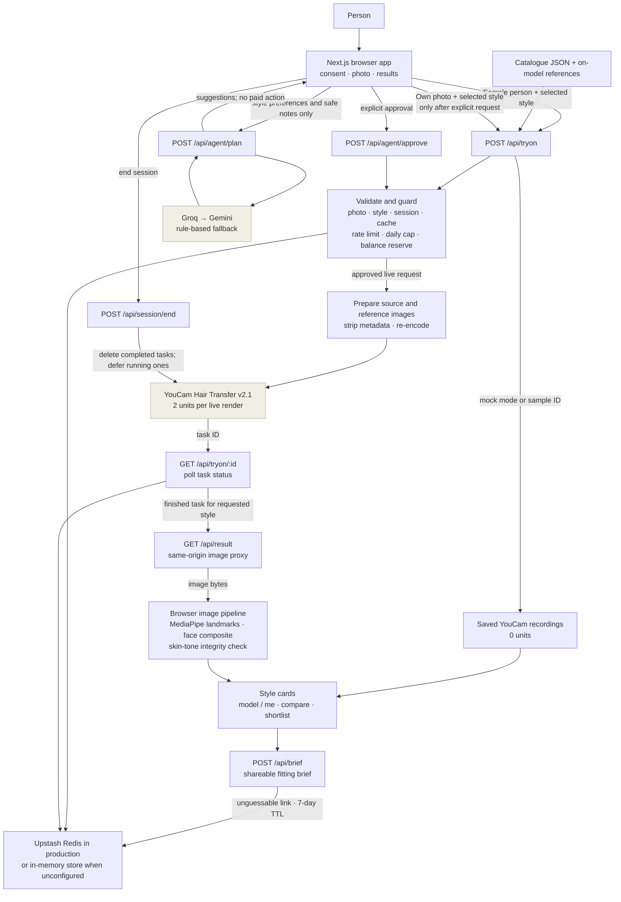

# Ahead architecture

This document describes the running implementation. Ahead is a Next.js web app with a server-side YouCam integration, browser-side image checks, an optional text planner, and a shareable fitting brief. The normal sample journey uses saved API recordings; the live own-photo journey is separately guarded.

## System map

## Request paths

### Recorded sample previews

1. The browser selects a catalogue style and sample-person ID.
2. `POST /api/tryon` sees that it is a sample request or that YouCam is in mock mode.
3. The server returns the matching saved recording ID. Sample faces never start a paid call, including when live mode is configured.
4. The browser displays the recording through the fixture route and runs its image integrity checks.

This is the no-key, zero-unit path used by local development and the default Playwright end-to-end configuration.

### Live own-photo try-on

1. The browser sends an image and catalogue style ID to `POST /api/tryon` only after the person asks to see matches.
2. The server validates the style and image, checks the tester gate if configured, and rejects unusable reference assets.
3. `lib/youcam/tryon.ts` checks the request cache, IP rate limit, live balance, daily cap, and judging reserve before starting the 2-unit Hair Transfer call. Cache identity includes the style, session, source image, reference image, and request options.
4. `lib/youcam/client.ts` uploads the prepared source and person-wearing-the-style reference, then creates a YouCam Hair Transfer v2.1 task using `hair_color: "ref"`.
5. The browser polls `GET /api/tryon/:id`. The server associates the returned YouCam task ID with the requested style in the ledger; the client rejects a mismatched style ID.
6. Once ready, `GET /api/result` reads the image and returns it through Ahead's origin. The browser checks and, when required, corrects the face region and skin-tone drift before displaying the card.
7. `POST /api/session/end` deletes completed tasks from YouCam. Tasks that are still running are marked for cleanup after their result is read.

Create requests that could have succeeded are not retried silently. Explicit transient errors may receive one retry; polling errors do not create another paid task.

### Planning and fitting brief

- `POST /api/agent/plan` returns style suggestions and optional planning text. Groq is tried before Gemini; if no provider is configured or providers fail, the rule-based planner responds.
- The planner does not receive the photo, treatment date, hair-loss stage, or health details. Paid try-ons are only proposed; `POST /api/agent/approve` is a separate, explicit approval step.
- `POST /api/brief` validates catalogue IDs, colour values, and plain-text notes, then stores only the selected references and notes with a seven-day expiry. The photo is not part of the brief payload or stored brief.
- The brief store and the live unit ledger/cache use Upstash Redis when configured. The app falls back to in-memory storage when those environment variables are absent; that fallback is intended for local work, not durable multi-instance production state.

## Code ownership

| Layer | Code | Responsibility |
| --- | --- | --- |
| Web routes and screens | `app/`, `components/` | Consent, photo selection, results, comparison, fitting brief, and planning UI. |
| Try-on API | `app/api/tryon/`, `app/api/result/route.ts` | Validate requests, create/poll jobs, and proxy completed image bytes. |
| YouCam client and controls | `lib/youcam/` | REST upload/task lifecycle, API errors, mock recordings, session deletion, rate limits, ledger, cache, and unit safeguards. |
| Product references | `catalogue/catalogue.json`, `public/` | The 12 wig and 4 wrap/cap style directions and their reference images. |
| Image integrity | `lib/image/`, `lib/client/image.ts` | Face landmarks, feathered inner-face restoration, colour checks, and optional feature compositing. |
| Planner and claims | `app/api/agent/`, `lib/agent/` | Optional language-model planning, rule fallback, user approval, health-detail filtering, and claim validation. |
| Brief storage | `app/api/brief/`, `lib/store/` | Validate and store photo-free fitting briefs with expiry. |
| Tests | `test/`, `playwright.config.ts` | Unit/API tests and mobile/desktop browser journeys. |

## Trust boundaries

- **Browser → Ahead server:** a photo is sent only for a requested live preview. The browser stores its working photo in session memory; the brief API never accepts it.
- **Ahead server → YouCam:** the server-side API key authenticates uploads and task calls. The browser does not receive the key or YouCam result URLs.
- **Ahead server → planner provider:** only validated style preferences and notes after health-detail filtering are eligible planner context. No photo or treatment stage is sent.
- **Persistent store:** brief contents, task/usage metadata, and cache references may be stored. User photo bytes are not stored in the brief or usage ledger.

## Verification boundaries

`npm run test:e2e` builds the application in mock mode and exercises the browser flow at 390 px and 1440 px widths. It verifies the app without consuming YouCam units. Live API integration tests use mocked HTTP responses. A successful mock-mode E2E run proves the user flow against recorded responses; it does not prove that a fresh production YouCam call or a retailer purchase integration is available.
